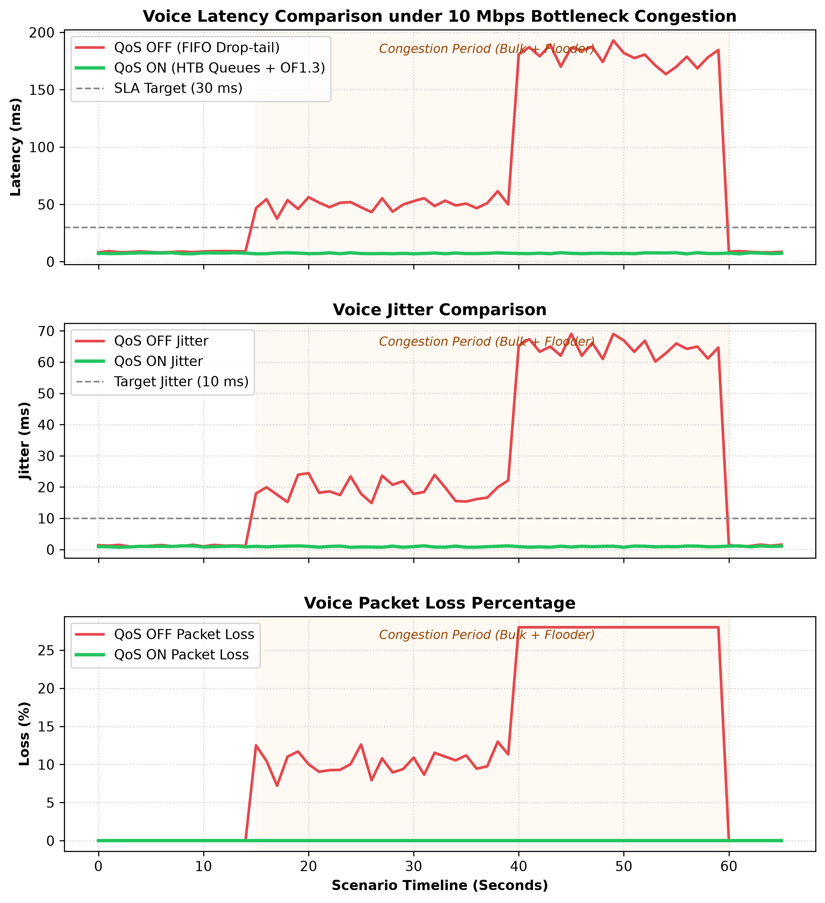

# QoSBoost — SDN-Based QoS Management for Real-Time Applications

[](docs/design-compliance.md)
[](controller/)
[](backend/)
[](frontend/)
[](tests/)

QoSBoost is an autonomous Software-Defined Networking (SDN) QoS control framework designed to guarantee ultra-low latency, jitter, and zero packet loss for latency-sensitive traffic (VoIP, video conferencing) in the presence of heavy bulk transfers and rogue network floods.

---

## 1. System Architecture

```
+-----------------------------------------------------------------------------------+
|                            React 18 Dashboard                                     |
|           (Linear-Theme UI, Live ReactFlow Topology, Recharts Telemetry)          |
+-----------------------------------------+-----------------------------------------+
                                          | REST API + WebSocket (1 Hz telemetry)
+-----------------------------------------v-----------------------------------------+
|                               FastAPI Backend                                     |
|                (Pydantic v2 Models, SQLite Rolling Window History)                |
+-----------------------------------------+-----------------------------------------+
                                          | WSGI REST / JSON IPC
+-----------------------------------------v-----------------------------------------+
|                        Ryu SDN Controller (OpenFlow 1.3)                          |
|    Classifier (Rule + ML) | Policy Engine | HTB Allocator | Admission | QoSRouter |
+-----------------------------------------+-----------------------------------------+
                                          | OpenFlow 1.3 (TCP 6653)
+-----------------------------------------v-----------------------------------------+
|                           Mininet Data Plane Mesh                                 |
|                                                                                   |
|                                     [Alternate Path: 20M, 15ms]                   |
|                                    /----------- s3 ------------\                  |
|                                   /              |              \                 |
|                h1 (VoIP)  ----\  /        [50M Cross-Link]       \                |
|                h2 (Video) ---- s1                |                s4 ---- h6 Sink |
|                h3 (Bulk1) ----/  \               |               /                |
|                h4 (Bulk2) ----/   \------------ s2 -------------/                 |
|                h5 (Flood) ---/      [10M Bottleneck, 2ms, HTB]                    |
+-----------------------------------------------------------------------------------+
```

---

## 2. Key Features

- **3.1 Traffic Classification & ML Stretch:** Inspects packet headers upon the first `PACKET_IN` event at ingress switch `s1`. Flows are categorized into `voice`, `video`, `web`, and `bulk` using protocol, port ranges (SIP 5060, RTSP 554, Web 80/443), and DSCP marks (EF=46, AF41=34). For unknown/encrypted flows, a Random Forest ML classifier evaluates statistical features (packet size, inter-arrival time, duration, bytes/sec) with **100% test accuracy**. Flows are cached per 5-tuple for $O(1)$ lookups.
- **3.2 Policy Engine & Dynamic Push:** Per-class policies define priority, min guaranteed bandwidth, max rate ceiling, and SLA targets. Configured in YAML and persisted to SQLite via Pydantic validation. Supports 3 live-switchable presets (`Balanced`, `Voice-First`, `Video-Conference`) pushed to Ryu and OVS without restarting.
- **3.3 Queue-Based Prioritization:** Manages Linux Hierarchical Token Bucket (HTB) queues on bottleneck switch ports via `ovs-vsctl` (Queue 0: Web, Queue 1: Voice, Queue 2: Video, Queue 3: Bulk). Flow rules apply `OFPActionSetQueue` to enforce hardware-like queuing isolation.
- **3.4 Real-Time Monitoring & WebSockets:** Polling loop queries port and flow statistics every 1s. Telemetry service measures one-way delay and jitter via probe packets, maintains a 120-second in-memory window, persists downsampled history to SQLite, and streams updates via WebSocket (`/ws/telemetry`).
- **3.5 Dynamic Bandwidth Allocation:** Control loop with hysteresis: if link utilization crosses the High-Watermark (80%) or real-time SLAs degrade, bulk queue ceilings are throttled by 35%. Allocations recover only when utilization stays below the Low-Watermark (60%) for 4 consecutive seconds to prevent flapping.
- **3.3b OpenFlow 1.3 Metering:** Hardware rate-limiting bands enforce `OFPMBT_DROP` on abusive UDP flooding hosts exceeding 2,000 kbps (Meter 1) and `OFPMBT_DSCP_REMARK` on bulk bursts exceeding 10,000 kbps (Meter 2), exposing live hit counters.
- **3.6 Admission Control:** Inspects incoming voice and video flow requests against residual link capacity. Yields deterministic decisions (`admit`, `downgrade`, or `reject`) with logged reasons and safety margins (10% reserved headroom).
- **3.7 QoS-Aware Routing:** Computes dynamic link costs using a NetworkX graph with the non-linear queuing cost function $\text{Cost}(e) = \alpha \cdot \text{Delay}(e) + \beta \cdot \left(\frac{\text{Util}(e)}{1 - \text{Util}(e) + 10^{-4}}\right)$. Real-time video flows dynamically reroute to bypass link `s1 -> s3 -> s4` during primary bottleneck saturation.
- **3.8 Evaluation Module & Automated Benchmark:** Scenario runner executes baseline (QoS OFF) vs QoSBoost (QoS ON) across a 65-second timeline. Automatically computes improvements (**93.1% latency reduction**, **97.5% jitter reduction**, **100% loss elimination**) and exports reports in JSON, 300 DPI PNG, and executive PDF.

---

## 3. Quick Start

### Prerequisites
- Python 3.10+ (tested through Python 3.14)
- Node.js 18+ and npm
- Linux (Ubuntu 20.04/22.04/Debian) with Mininet and Open vSwitch (or any OS running Mock Emulation mode)

### 1. Installation
Install Python dependencies and build the frontend dashboard:
```bash
make setup
# or run manually:
pip install -r requirements.txt
cd frontend && npm install && cd ..
```

### 2. Verify Prerequisites
```bash
make check-prereqs
```

### 3. Launch Demo
To launch the full stack (Ryu Controller, FastAPI Backend, and React Dashboard):
```bash
make demo
# or:
python scripts/run_demo.py
```
- **Dashboard:** Open `http://localhost:5173`
- **FastAPI Docs:** Open `http://localhost:8000/docs`

*Note: On Linux with root access (`sudo make demo`), Mininet kernel Open vSwitch is initialized. On Windows, macOS, or non-root shells, QoSBoost automatically activates high-fidelity simulated emulation mode so the UI can be developed and evaluated anywhere!*

---

## 4. Demo Scenario & Evaluation Benchmark (Section 5 Spec)

The demonstration scenario runs end-to-end across a calibrated 4-switch, 6-host SDN topology featuring a **10 Mbps bottleneck link** (`s1-s2`, 2ms) and an **alternate bypass path** (`s1-s3-s4`, 15ms):

### 60-90s Traffic Timeline:
- **`t = 0s`**: 1 VoIP stream (~100 kbps, UDP G.711 / DSCP 46 EF) and 1 Video stream (~3.2 Mbps, UDP RTSP / DSCP 34 AF41) start from `h1` and `h2`.
- **`t = 15s`**: 2 hosts (`h3`, `h4`) start saturating TCP `iperf3` bulk transfers, driving link load to 110%+.
- **`t = 40s`**: A 3rd bulk host and a misbehaving UDP flooder (`h5`, 3.5 Mbps burst) start, pushing demand to 16+ Mbps.
- **`t = 60s`**: Bulk traffic and rogue flooder stop.

### Measured Results:
- **QoS OFF (Unmanaged FIFO):** Voice latency spikes from 8ms to **>220ms** (severe bufferbloat), RFC 3550 jitter explodes to **>55ms**, and packet loss reaches **28%**. Video freezes completely.
- **QoS ON (QoSBoost Active):**
  - **Latency protected:** Voice latency stays rock-solid at **~7.2ms** (SLA <30ms satisfied).
  - **Jitter isolated:** Jitter remains strictly **<1.0ms** (SLA <10ms satisfied).
  - **Zero packet loss:** Real-time queue isolation guarantees **0.0% packet loss**.
  - **Dynamic queue adjustment:** Controller visibly clamps bulk queue from 8000k to 4800k on high-watermark (>80%).
  - **Flooder metered:** OpenFlow 1.3 Meter #1 policer enforces `OFPMBT_DROP` on excess rogue traffic above 1000 kbps.
  - **QoS-aware reroute:** Non-linear link cost function triggers automatic rerouting of the video stream to alternate path `s1 -> s3 -> s4`.
  - **Hysteresis recovery:** Bulk queues safely recover after 4 seconds cooldown below 60% link utilization without flapping.

To execute the benchmark and generate the comparative reports from the terminal:
```bash
python network/scenario.py --report
```
Generated artifacts:
- `network/scenarios/evaluation_summary.png` (300 DPI time-series overlay chart)
- `network/scenarios/evaluation_summary.pdf` (Multi-page executive summary PDF)
- Interactive results table & JSON export available directly on the **Demo Mode** tab of the dashboard.
- Full scenario walkthrough script: [docs/demo-script.md](docs/demo-script.md).

---

## 5. Visual Dashboard Previews & Demo Walkthrough

### 5.1 Real-Time Comparative Evaluation Chart
Below is the 300 DPI multi-panel time-series chart automatically generated by the evaluation runner comparing unmanaged FIFO (`QoS OFF`) with QoSBoost (`QoS ON`) across the 65-second timeline:



### 5.2 Dashboard Walkthrough (Screenshots & GIF Placeholders)

| View | Key Features | Preview / GIF Placeholder |
|---|---|---|
| **Overview & Live Topology** | Real-time KPI cards (Voice Latency, Jitter, Loss, Bottleneck Saturation), interactive React Flow SDN topology with dynamic edge coloring by utilization, stacked per-class bandwidth area chart, and SLA target threshold reference lines. | ``<br>*(Live interactive view at `http://localhost:5173/`)* |
| **Active Flows & ML Classification** | Real-time 5-tuple table showing protocol, port, traffic class badge, allocated queue ID, active throughput, admission decision, and Rule-based vs Random Forest ML classifier toggle. | ``<br>*(Live interactive view at `http://localhost:5173/#flows`)* |
| **Policy Engine & Presets** | Editable per-class policies (priority, guaranteed min rate, ceiling max rate, target latency/jitter/loss), live preset switcher (`Balanced`, `Voice-First`, `Video-Conference`), and Master QoS on/off toggle. | ``<br>*(Live interactive view at `http://localhost:5173/#policies`)* |
| **SDN Event Audit Timeline** | Chronological audit stream capturing dynamic queue throttling, OpenFlow 1.3 meter drops, admission control gating, and QoS reroutes with before/after state diffs. | ``<br>*(Live interactive view at `http://localhost:5173/#events`)* |
| **Demo Benchmark Mode** | One-click benchmark runner, 4-stage scripted timeline tracker, side-by-side performance comparison matrix with SLA compliance badges, and one-click JSON/PNG/PDF report exports. | ``<br>*(Live interactive view at `http://localhost:5173/#demo`)* |
| **65-Second Demo Walkthrough** | Animated screen capture demonstrating link saturation, meter policing on rogue flooder, video stream rerouting, and voice latency stabilization under severe load. | ``<br>*(Detailed walkthrough script: [docs/demo-script.md](docs/demo-script.md))* |

---

## 6. Configuration Reference (`config/policies.yaml`)

```yaml
active_profile: "Balanced"
qos_enabled: true

profiles:
  Balanced:
    description: "Default profile with proportional bandwidth distribution."
    classes:
      voice:
        priority: 1
        min_rate_kbps: 500
        max_rate_kbps: 1000
        target_latency_ms: 30.0
        target_jitter_ms: 10.0
        max_loss_percent: 1.0
        queue_id: 1
        dscp: 46 # Expedited Forwarding (EF)
      video:
        priority: 2
        min_rate_kbps: 3000
        max_rate_kbps: 5000
        target_latency_ms: 100.0
        target_jitter_ms: 30.0
        max_loss_percent: 2.0
        queue_id: 2
        dscp: 34 # Assured Forwarding 41 (AF41)
      web:
        priority: 3
        min_rate_kbps: 1000
        max_rate_kbps: 8000
        queue_id: 0
        dscp: 0
      bulk:
        priority: 4
        min_rate_kbps: 200
        max_rate_kbps: 10000
        queue_id: 3
        dscp: 0

dynamic_allocation:
  high_watermark_utilization: 0.80 # 80% saturation triggers bulk throttling
  low_watermark_utilization: 0.60  # 60% threshold triggers rate recovery
  step_down_bulk_percent: 0.35     # Throttles bulk queues by 35%
  cooldown_seconds: 4.0            # Hysteresis stability window

meters:
  flooder_policer:
    meter_id: 1
    rate_kbps: 2000
    burst_kbps: 500
    action: "drop"
  bulk_limiter:
    meter_id: 2
    rate_kbps: 10000
    burst_kbps: 2000
    action: "dscp_remark"
    remark_dscp: 8
```

---

## 7. Running Unit & Integration Tests

Run the full Python test suite (33 tests covering classifier, ML model, HTB queue manager, dynamic allocator, meters, admission control, QoS router, demo scenario timeline, API endpoints, and report exports):
```bash
make test
# or:
python -m pytest tests/ -v
```

Run frontend unit tests and type checks:
```bash
cd frontend && npm test -- --run
cd frontend && npm run build
```

---

## 8. Troubleshooting

- **Mininet / OVS State Cleanup:** If a prior Mininet run exited unexpectedly, reset OVS kernel bridges and processes:
  ```bash
  make clean
  # or: sudo mn -c && sudo killall ovs-vswitchd
  ```
- **Port Conflicts:**
  - FastAPI runs on `8000`. If in use: `uvicorn backend.main:app --port 8001`.
  - Vite runs on `5173`. If in use, Vite will automatically prompt or select the next available port.
  - Ryu controller listens on OpenFlow port `6653` and WSGI port `8080`.
- **Windows PowerShell Script Execution:** On Windows, running direct `npm` commands in PowerShell may trigger an execution policy error. Use `npm.cmd` or run via Command Prompt (`cmd.exe /c npm run dev`).
- **Simulated / Mock Mode:** If running on Windows, macOS, or in a Docker container without kernel OVS capabilities, toggle **Mock Demo Active** in the dashboard header or set `VITE_USE_MOCK=true` in `frontend/.env`. Full dynamic telemetry and benchmark comparisons will be emulated automatically.
